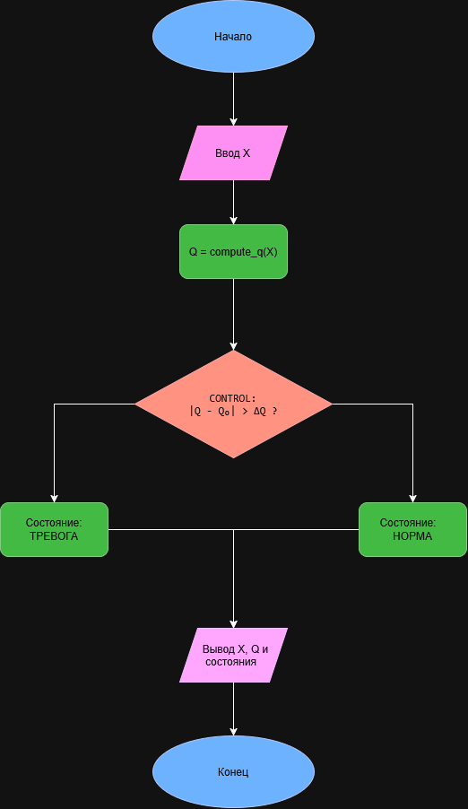
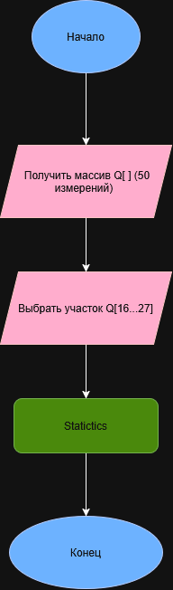

# Курсовой проект по программированию — вариант 33

## Тема

Мониторинг технологического параметра реактора: расход азота.

## 1. Постановка задачи

Разработать программу на языке C для преобразования показаний датчика расхода азота `X` в показатель `Q(X)`, оперативного контроля состояния процесса и последующего статистического анализа заданного участка выборки.

На этапе КТ1 реализуется каркас программы и декомпозиция основных этапов на отдельные функции.

## 2. Исходные данные

| Параметр | Значение |
|---|---|
| Измеряемая величина | Расход азота X |
| Единица измерения | л/мин |
| Диапазон X | 5–70 л/мин |
| Количество измерений | 50 |
| Базовое значение | Q₀ = 50 |
| Допустимое отклонение | ΔQ = 7 |
| Участок статистического анализа | Q[16..27] |

## 3. Преобразование показания

Показание датчика преобразуется по кусочной функции:

```math
Q(X)=
\begin{cases}
\dfrac{(X-20)^2}{6}+10, & X<20,\\
3(X-32.5)+50, & 20\le X\le45,\\
2\sqrt{X-45+1}+60, & X>45.
\end{cases}
```

Допустимый диапазон входного значения:

```math
5\le X\le70.
```

## 4. Архитектура программы

Обработка одного показания выполняется по цепочке:

```text
X → compute_q(X) → Q → CONTROL → STATE
```

Основные функции программы:

- `read_input()` — чтение и проверка входного значения X;
- `compute_q()` — вычисление Q(X);
- `control()` — сравнение Q с допустимым диапазоном;
- `compute_statistics()` — статистический анализ участка Q[16..27].

Функция `compute_statistics()` на этапе КТ1 является заглушкой. Работа с массивом измерений и полноценная статистика выполняются на следующем этапе.

## 5. Блок-схемы

### Блок-схема 1. Преобразование и контроль

Цепочка:

```text
X → f(X) → Q → CONTROL → STATE
```



### Блок-схема 2. Статистический анализ

Цепочка:

```text
Q[] → Q[16..27] → STATISTICS
```



## 6. Алгоритм работы

1. Получить показание расхода азота `X`.
2. Проверить корректность ввода и условие `5 ≤ X ≤ 70`.
3. Передать `X` в функцию `compute_q()`.
4. Рассчитать `Q(X)` по соответствующей ветви кусочной функции.
5. Передать полученное значение `Q` в блок `CONTROL`.
6. Вычислить отклонение `|Q - Q₀|`.
7. Определить состояние процесса:
   - `НОРМА`, если `|Q - Q₀| ≤ 7`;
   - `ТРЕВОГА`, если `|Q - Q₀| > 7`.
8. Вывести значение `X`, значение `Q` и состояние.
9. Блок `STATISTICS` предназначен для анализа участка `Q[16..27]` и будет реализован на следующем этапе.

## 7. Ручные контрольные расчёты

### Тест 1 — нижняя ветвь

При `X = 10`:

```math
Q(10)=\dfrac{(10-20)^2}{6}+10
```

```math
Q(10)=\dfrac{100}{6}+10\approx26.67
```

Отклонение:

```math
|26.67-50|=23.33
```

Так как `23.33 > 7`, состояние:

```text
ТРЕВОГА
```

### Тест 2 — средняя ветвь

При `X = 32.5`:

```math
Q(32.5)=3(32.5-32.5)+50=50
```

Отклонение:

```math
|50-50|=0
```

Так как `0 ≤ 7`, состояние:

```text
НОРМА
```

### Тест 3 — верхняя ветвь

При `X = 60`:

```math
Q(60)=2\sqrt{60-45+1}+60
```

```math
Q(60)=2\sqrt{16}+60=68
```

Отклонение:

```math
|68-50|=18
```

Так как `18 > 7`, состояние:

```text
ТРЕВОГА
```

## 8. Проверка и ограничения

Входное значение должно:

- быть числом;
- находиться в диапазоне от 5 до 70 л/мин.

На этапе КТ1 программа работает с одним показанием и демонстрирует архитектуру:

```text
READ → Q → CONTROL → STATE → STATISTICS
```

Массив из 50 измерений и реальная обработка участка `Q[16..27]` будут реализованы на следующем этапе.
## Разработчик

Орлов Даниил, группа БИЦТ-262
